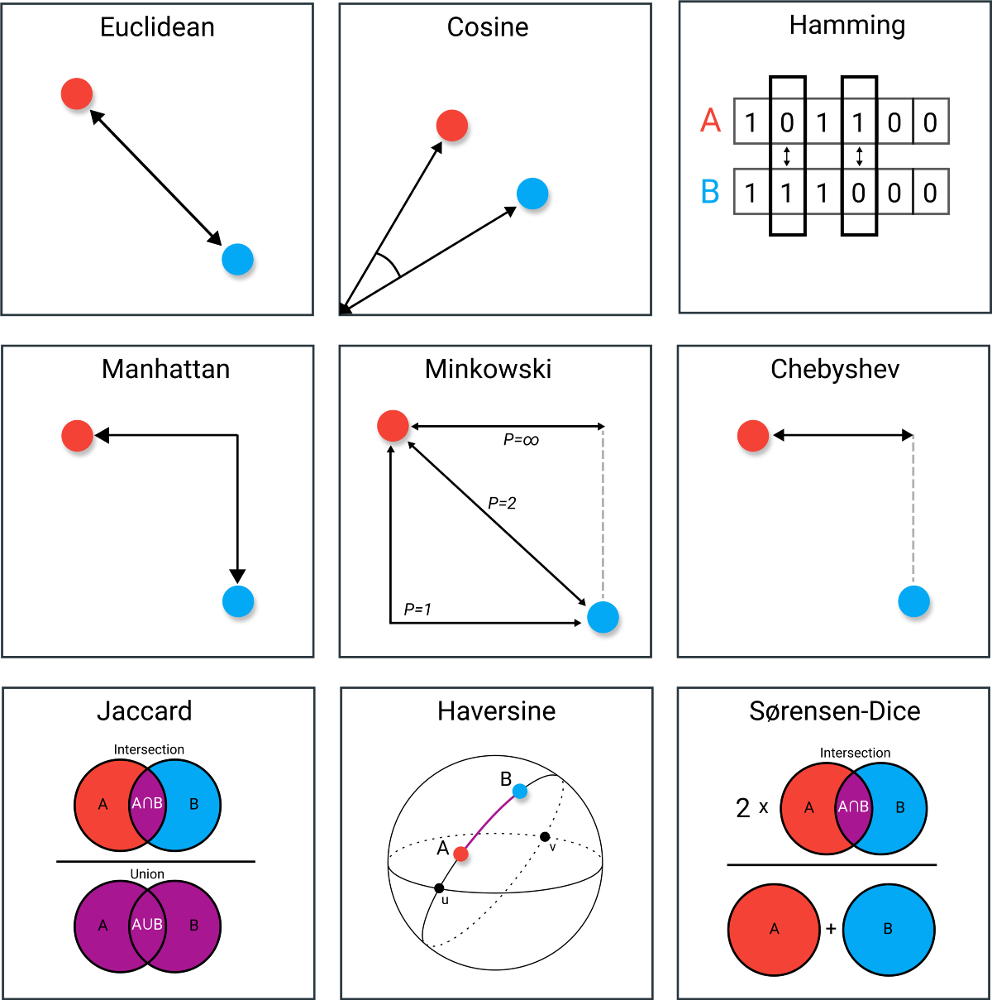

# Clustering

## Types of Clustering Algorithms

- **Partitioning Methods**
- **Hierarchical Methods**
- **Density-Based Methods**
- **Model-Based Methods**
- **Grid-Based Methods**

## Common Clustering Algorithms

| Type | Scalability | Shape of Clusters | Sensitivity to Outliers |
|------|-------------|--------------------|-----------------------|
| Partitioning | High | Typically spherical | High |
| Hierarchical | Low to Medium | Can capture various shapes | Medium |
| Density-Based | Medium | Arbitrary shapes | Low |
| Model-Based | Medium | Based on assumed model | Medium |
| Grid-Based | High | Depends on grid resolution | Low |

> **Note:** Choosing the right clustering algorithm depends on the characteristics of the data and the problem at hand.

## Distance Metrics

**Euclidean**, **Manhatan**, and **Minkowski** are the most used distance metrics for numerical values and **Jaccard** and **cosine** distance metrics are most used metrics for non-numerical data.

> **Note:** Cosine distance metric mostly used for high-dimensional data or text analysis.

## Evaluation Metrics

In clustering we use evaluation metrics to:

Determine the optimal number of clusters, Compare different clustering algorithms, and Assess the quality and meaningfulness of the clusters.

**Internal evaluation metrics:**

- Silhouette coefficient
- Calinski-Harabasz index
- Davies-Bouldin index

**External evaluation metrics:**

- Adjusted Rand Index (ARI)
- Normalized Mutual Information (NMI)

> **Note:** Always consider visualizing the clusters to complement the evaluation metrics.